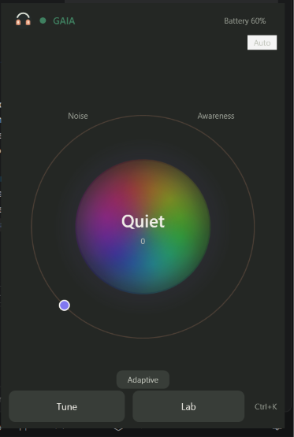
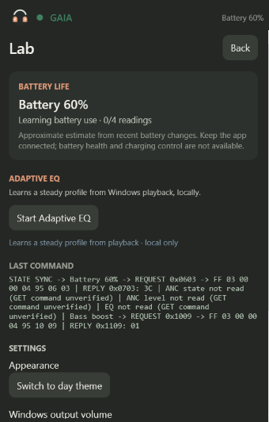

# Sennheiser Tray

A Windows desktop app for controlling compatible Sennheiser headphones over Bluetooth. It provides sound modes, noise-control settings, equalizer tuning, and local playback analysis.

The interface uses a warm, neutral palette with a softly blended, continuously shifting RGB wash over the audio-responsive orb.

## Screenshots

### Home



### Lab



## Features

- Connect to a paired headset that exposes the Sennheiser GAIA Bluetooth control service.
- Select Music, Movie, Gaming, Calls, or Focus sound modes.
- Adjust ANC and Adaptive ANC when supported by the headset.
- View battery level when the headset reports it over GAIA; unsupported or unavailable readings are shown as `Battery --`.
- See a battery-life estimate in the Lab screen after enough recent readings show a clear battery trend. It needs at least four readings over six minutes and a detectable level change; the estimate and charging state are approximate and inferred from the trend.
- See an inferred lightning-bolt charging indicator after the battery trend shows a sustained rise. A low-battery notification appears at 20% and is re-armed after the battery rises above 25%.
- Use the system-tray menu to open the app, switch sound profiles or noise-control modes, and adjust Windows playback volume in 5% steps.
- Enable automatic headset detection and connection, and optionally launch the app when you sign in to Windows. Detection checks for compatible paired headsets every 20 seconds while disconnected and shows a brief notification after an automatic connection.
- See the custom headset icon in the widget header, window/taskbar icon, and system tray.
- Orb rendering pauses when the home view is hidden, and the audio-responsive color wash uses fewer gradient layers to reduce idle rendering work.
- Adjust the current Windows default playback device volume from the Lab settings.
- Tune five equalizer bands and toggle Bass Boost and Bass Impact.
- Enable Adaptive EQ, which learns a steady profile from Windows playback locally. Playback analysis does not capture microphone audio or send data over the network. The dormant automatic-mode signal source uses foreground process names and active microphone-session metadata, never microphone audio.
- Use Focus Cycle in Focus mode.
- Switch between the warm day theme and a low-glare dark night theme; the choice is saved locally.

Available controls depend on the headset model and firmware. Pairing alone does not guarantee that a headset exposes the control service this app requires.

## Requirements

- Windows 11
- .NET 8 SDK to build from source
- Bluetooth adapter and a paired, compatible Sennheiser headset

## Build and run

From the repository directory, run in PowerShell:

```powershell
dotnet restore .\SennheiserTray.csproj
dotnet build .\SennheiserTray.csproj
dotnet run --project .\SennheiserTray.csproj
```

Run the Windows-targeted unit tests with:

```powershell
dotnet test .\SennheiserTray.Tests\SennheiserTray.Tests.csproj
```

## Getting started

1. Pair and power on your headset in **Windows Settings → Bluetooth & devices**.
2. Launch Sennheiser Tray.
3. In **Lab → Settings**, enable **Connect automatically when headset is available** and, if desired, **Launch with Windows**. The app remembers your selected headset and reconnects when it becomes available.
4. Choose a sound mode, then use the ANC control, **Tune**, or **Lab** to adjust available settings.

Use **Escape** to close the current drawer. The global mute shortcut can be selected in Lab settings; registration conflicts are shown there. Use the system-tray icon's right-click menu for quick controls, restart, or exit. Launching the app again brings the existing instance forward.

## ACCENTUM Plus testing

**Test status: results not yet documented.** This repository does not include verified ACCENTUM Plus test results; compatibility and individual controls should not be considered confirmed based on this README alone.

Record results using a paired **Sennheiser ACCENTUM Plus Wireless** headset. Include the headset firmware version, Windows version, and test date.

| Test | Result |
|---|---|
| Headset appears in the device list and connects | Not recorded |
| Sound mode selection (Music, Movie, Gaming, Calls, Focus) | Not recorded |
| ANC mode and level changes | Not recorded |
| Battery level | Not recorded |
| Equalizer and bass controls | Not recorded |
| Reconnect behavior | Not recorded |

Replace each “Not recorded” entry with the observed result and any relevant limitations after testing.

## Repository layout

- `Controls/` — WPF controls and their XAML/code-behind files.
- `Views/` — the main application window.
- `ViewModels/` — presentation state and UI commands.
- `Services/` — Bluetooth, audio analysis, and Windows integration.
- `Models/` — device, sound-mode, and protocol result models.
- `Core/` — mode, protocol, and interaction rules.
- `Infrastructure/` — logging, settings, and common command/property helpers.
- `Themes/` — application colors and control styles.
- `SennheiserTray.Tests/` — focused tests for mode selection, auto-mode rules, reconnect backoff, and GAIA framing.

## Troubleshooting

- **Headset not listed:** Check that it is paired and powered on. The headset must expose the GAIA Bluetooth control service.
- **Battery unavailable:** The connected headset or firmware may not provide a battery response over GAIA.
- **Battery estimates and charging indicator:** These are inferred from battery readings, not reported directly by the headset. The indicator requires four readings across at least six minutes and a detectable level change. Estimates may vary with playback volume, ANC, and other usage. Battery health and charging control are not exposed by the battery data currently supported by the app.
- **Volume control:** The Lab slider changes Windows’ default playback-device volume, not a GAIA headset-volume command.
- **Connection or control errors:** Reconnect the headset and retry. Some functions vary by model or firmware.
- **Application logs:** Logs are stored locally in `%LOCALAPPDATA%\SennheiserTray\logs`; older logs are removed after 30 days.

## Technology

WPF desktop app targeting .NET 8 for Windows. Uses NAudio for Windows audio analysis and Windows Bluetooth RFCOMM APIs for headset communication.
